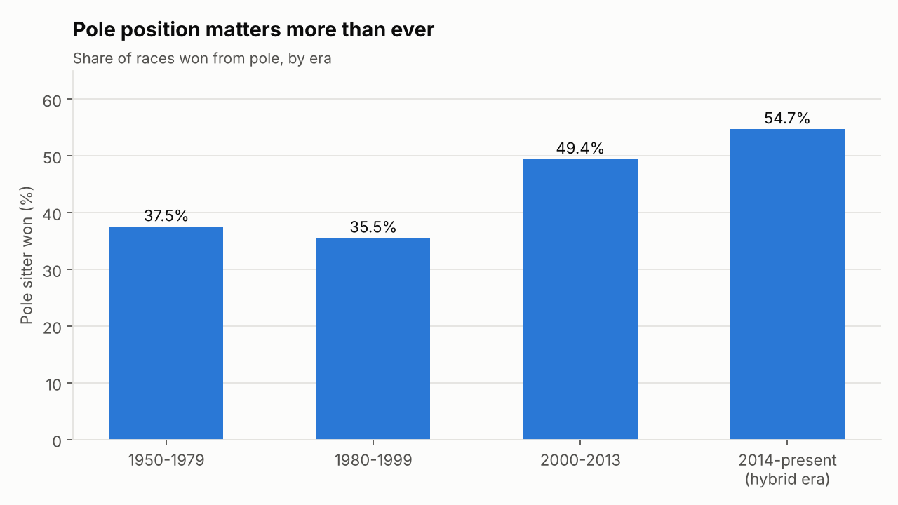
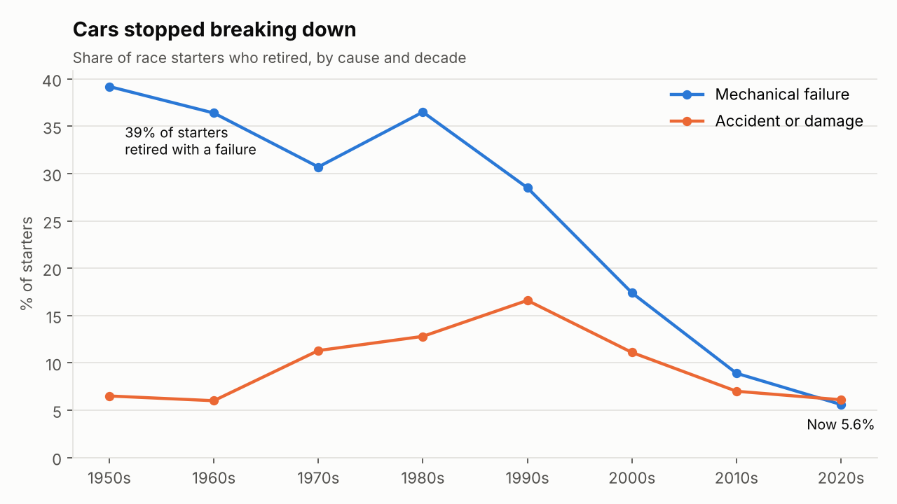
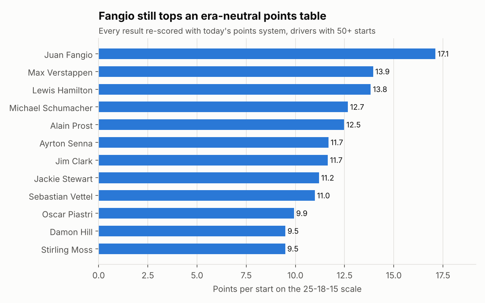
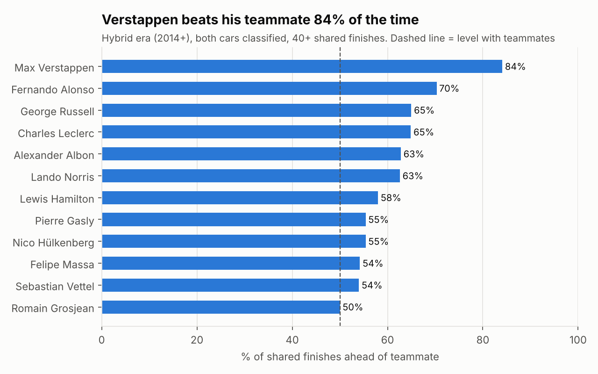
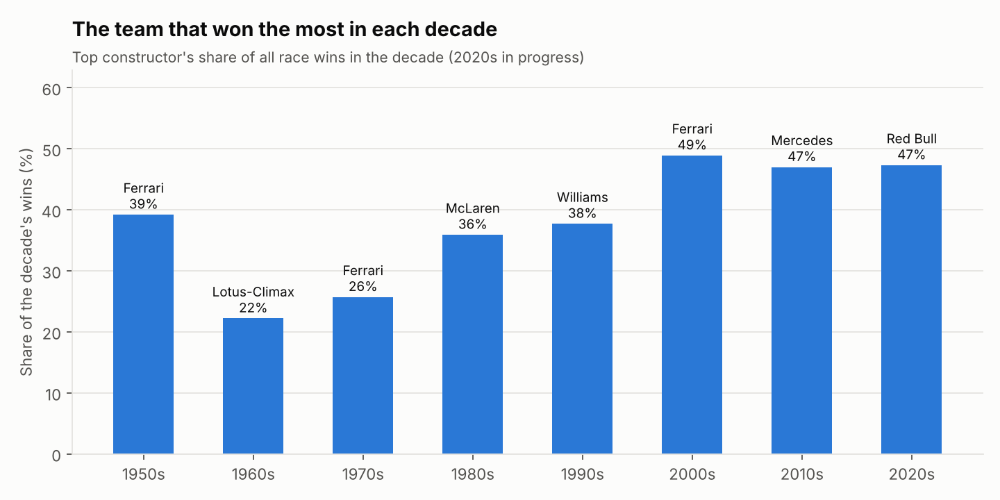
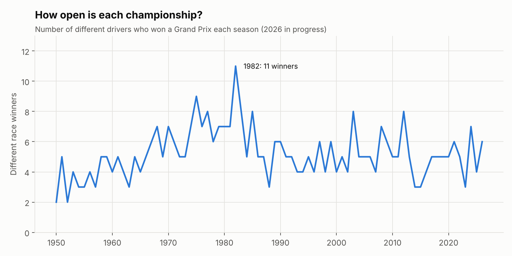

# Formula 1 Performance Analysis in SQL (1950 to 2026)

Data cleaning and exploratory data analysis of every Formula 1 World Championship race, written in MySQL.

The project takes 114,000 rows of raw race data, audits it for quality problems, cleans it into a typed relational model with keys and constraints, checks the result against the official championship tables, and then answers 22 questions about drivers, teams and how races are won.

**Tools:** MySQL 8 (CTEs, window functions, views, constraints), Python (pandas and matplotlib for charts only)

---

## Key findings

1. **Pole position matters more than ever.** The pole sitter won 36% of races in 1980-1999. In the hybrid era (2014 onward) that rose to 55%, and 78% of hybrid-era races were won from the front row.
2. **Cars stopped breaking down.** In the 1950s, 39% of starters retired with a mechanical failure. In the 2020s it is 5.6%, and crashes now end more races than failures do. The share of starters who reach the finish rose from about 50% to 87%.
3. **Fangio is still the benchmark.** Re-scoring every result with today's 25-18-15 points system, Juan Manuel Fangio averaged 17.1 points per start. Verstappen (13.9) and Hamilton (13.8) are next. Fangio also has the best win rate of anyone with 50+ starts (47%).
4. **Hamilton leads the volume records:** 106 wins, 104 poles and 208 podiums. Schumacher (91) and Verstappen (73) follow on wins.
5. **Verstappen dominates his teammates more than anyone.** Since 2014 he finished ahead of his teammate in 84% of races where both cars finished, across eight different teammates. Alonso is second at 70%.
6. **Red Bull's 2023 season was the most dominant of the modern era:** 21 wins from 22 races (95.5%), ahead of McLaren 1988 (93.8%) and Mercedes 2016 (90.5%).
7. **Mercedes built the most reliable hybrid-era car.** Only 3.9% of its starts since 2014 ended in a mechanical retirement, against 15.3% for Toro Rosso.
8. **Where you qualify depends on the track.** Since 2000 the pole sitter has won about 70% of the time at Singapore, Abu Dhabi, Barcelona and Suzuka, but only 32% at Silverstone.

| | |
|---|---|
|  |  |
|  |  |
|  |  |

---

## Dataset

The data is the Ergast-format Formula 1 database (the same schema as the well-known Kaggle "Formula 1 World Championship" dataset), taken from the [TracingInsights RaceData archive](https://github.com/TracingInsights/RaceData), which keeps it up to date and publishes it under CC0. The snapshot runs from the 1950 British Grand Prix to the 2026 Singapore Grand Prix (17 of 23 rounds of the 2026 season), so 2026 figures are partial.

| File | Rows | What it holds |
|---|---|---|
| results.csv | 27,612 | One row per car per race: grid, finish, points, status |
| races.csv | 1,172 | Every race, including the 6 not yet run in 2026 |
| drivers.csv | 881 | Driver details |
| constructors.csv | 214 | Teams |
| qualifying.csv | 11,342 | Qualifying lap times (1994 onward) |
| sprint_results.csv | 612 | Sprint races (2021 onward) |
| driver_standings.csv, constructor_standings.csv | 49,559 | Championship table after every round |
| pit_stops.csv | 22,802 | Pit stops (2011 onward) |
| circuits.csv, status.csv | 221 | Lookup tables |

---

## Data quality problems found

`sql/02_profiling.sql` runs 16 checks on the raw files. Saved output: [`outputs/02_profiling_output.txt`](outputs/02_profiling_output.txt).

| # | Problem | Scale |
|---|---|---|
| P1 | Missing values stored as the text `\N` instead of NULL | 10,953 positions, 19,415 race times, 818 driver numbers |
| P3 | The race `time` column mixes total race time (`1:34:50.616`) with gaps (`+5.478`, `+1 Lap`), plus one malformed value (`2:4:44.859`) | 8,197 values |
| P4 | `grid = 0` means "started from the pit lane" or "did not start", not a grid slot | 1,638 rows |
| P5 | `positionText` packs six outcomes into letter codes (R, D, E, W, F, N) | 11,077 rows |
| P6 | 143 free-text retirement reasons, too granular to analyse | 143 values |
| P7 | Same driver twice in one race (1950s shared cars) | 85 driver-race pairs |
| P8 | Inconsistent nationality: `Argentinian ` (trailing space) vs `Argentine` | 1 row |
| P9 | Placeholder drivers who never entered any session, with no birth date or nationality | 16 rows |
| P10 | Scheduled 2026 races with no results yet | 6 races |
| P12 | Points systems changed many times (8, 9, 10, then 25 for a win, plus double points in 2014), so raw points are not comparable across eras | all seasons |
| P14 | `position` and `positionText` disagree: two 2005 rows are classified but have no position; from 2025 the source fills `position` for retired cars too | 128 rows |
| P15 | Two 2026 sprint rows have no status at all | 2 rows |
| P16 | An impossible qualifying lap: `16:42.640` at the 1995 Japanese GP, where pole was 1:38.023 | 1 row |

Checks that passed: no duplicate rows (even ignoring IDs), no orphaned foreign keys, and every lap time string matches `m:ss.sss`.

## Cleaning steps

`sql/03_cleaning.sql` builds typed tables from the raw layer. The raw tables are all `VARCHAR` and loaded with `ESCAPED BY ''`, so nothing is silently converted on load and every fix is visible in SQL.

| Step | Fix |
|---|---|
| C1 | `NULLIF(col, '\N')` on every nullable column |
| C2 | Cast to INT, DECIMAL, DATE and TIME |
| C3 | `TRIM()` all text and merge `Argentinian` into `Argentine` |
| C4 | Convert lap and qualifying times from `m:ss.sss` to milliseconds |
| C5 | `grid = 0` becomes NULL, with a separate `pit_lane_start` flag |
| C6 | Decode `positionText` into one `outcome` column (Classified, Retired, Disqualified, Did not start, Did not qualify, Not classified). Finish position is taken from `positionText`, which fixes the P14 rows |
| C7 | Group the 143 status values into 10 categories (Finished, Lapped, Mechanical, Accident / damage, and so on) |
| C8 | Drop the 16 placeholder drivers |
| C9 | Flag future races with `is_completed = 0` |
| C10 | Add `points_2010_scale`: every classified top-10 finish re-scored on the 25-18-15-12-10-8-6-4-2-1 system |
| C11 | Primary keys, unique keys and 15 foreign keys |
| C12 | Set the impossible qualifying lap to NULL rather than guess a value |

The script ends by creating `v_results`, a view that joins each result to its race, driver, team and status category. All the analysis builds on it.

## Validation

`sql/04_validation.sql` checks the cleaned data. Saved output: [`outputs/04_validation_output.txt`](outputs/04_validation_output.txt).

- Row counts match the raw files (except the 16 dropped placeholder drivers).
- No `\N` text remains, every race after 1960 has exactly one winner, and no grid slot is 0.
- **Points reconcile with the official standings.** For every season since 1991, each driver's race and sprint points add up exactly to their final championship total. Before 1991 only a driver's best results counted, so earlier seasons are expected to differ.

---

## Analysis questions

| Script | Questions |
|---|---|
| [`05_eda_drivers.sql`](sql/05_eda_drivers.sql) | Most wins, podiums and poles. Best win rate (50+ starts). Era-neutral points per start. Champions and winning margins. Most titles. Consistency (average and spread of finishing position). Places gained from grid to flag. Teammate head-to-head. Youngest winners. |
| [`06_eda_constructors.sql`](sql/06_eda_constructors.sql) | All-time team table with 1-2 finishes. Leading team per decade. Most dominant seasons. Constructors' champions. Hybrid-era reliability. Median pit stop time per team. |
| [`07_eda_race_dynamics.sql`](sql/07_eda_race_dynamics.sql) | Pole-to-win rate by era. Which grid slots winners start from. Retirement rate and cause by decade. Field size and finishers. Circuits where pole matters most. Different winners per season. Year-over-year change in the leading team. |

Full outputs for every query are saved in [`outputs/`](outputs/).

SQL techniques used: CTEs (including chained CTEs), window functions (`RANK`, `ROW_NUMBER`, `LAG`, `SUM() OVER`, `MIN() OVER`), self-joins (teammate comparison), a median calculated without a `MEDIAN()` function, conditional aggregation, `GROUP_CONCAT`, views, and multi-table `UPDATE` with a derived table.

## Limitations

- 2026 is a season in progress, so 2026 totals and the 2020s decade are incomplete.
- "Pole" means starting from grid slot 1. After grid penalties this can differ from the official pole sitter.
- Teams that changed name are separate constructors in the source (Toleman, Benetton, Renault and Alpine are four teams), so team totals are per name.
- Pit stop times are total time in the pit lane, not stationary time, and stops over 60 seconds (red flags, repairs) are excluded.
- Places gained favours drivers who started further back, since a pole sitter cannot gain places.

---

## How to run it

Requires MySQL 8 (MariaDB 10.6+ also works). The scripts were tested end to end on MariaDB 10.11 with strict SQL mode and ONLY_FULL_GROUP_BY on. Run from the repository root:

```bash
mysql -u root -p < sql/00_setup.sql
mysql --local-infile=1 -u root -p < sql/01_load_raw.sql   # server needs local_infile=ON
mysql -u root -p < sql/02_profiling.sql
mysql -u root -p < sql/03_cleaning.sql
mysql -u root -p < sql/04_validation.sql
mysql -u root -p < sql/05_eda_drivers.sql
mysql -u root -p < sql/06_eda_constructors.sql
mysql -u root -p < sql/07_eda_race_dynamics.sql

# optional: rebuild the charts
pip install pymysql pandas matplotlib
MYSQL_USER=root MYSQL_PASSWORD=yourpassword python python/make_charts.py
```

If `LOAD DATA LOCAL INFILE` is refused, run `SET GLOBAL local_infile = 1;` as an admin first.

## Repository layout

```
data/raw/      original CSV files, unchanged
sql/           00-07, run in order
outputs/       saved results of every SQL script, plus chart data as CSV
charts/        PNG charts used in this README
python/        chart script
```
